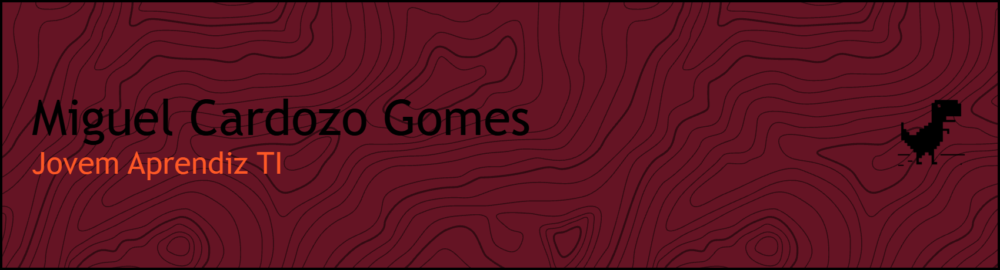

Sou jovem Aprendiz de TI na **Telefónica Tech** (Vivo Empresas), onde trabalho com redes, automação de processos e banco de dados. Estudo Análise e Desenvolvimento de Sistemas na Fatec Santana de Parnaíba e sou técnico em Desenvolvimento de Sistemas pela ETEC.

Comecei pelo código e fui parar na infraestrutura: hoje o que mais me interessa é entender como as coisas se conectam e como fazer tarefas repetitivas rodarem sozinhas. 

Cajamar-SP

## Ferramentas

## Projetos

**Vida TEA**, TCC da ETEC, em grupo
App mobile de apoio a famílias de crianças com TEA. Fui responsável pelo back-end e pelo banco de dados MySQL.

**Portfólio com API REST**
API em ASP.NET Core com Entity Framework e SQLite, mais aplicações em JavaScript com CRUD.
[Ver portfólio](https://miguel-cardozo.github.io/miguel-dev-landing/)

## Contato
[miguelcardozogomes@gmail.com](mailto:miguelcardozogomes@gmail.com) · [LinkedIn](link-do-linkedin)

  

